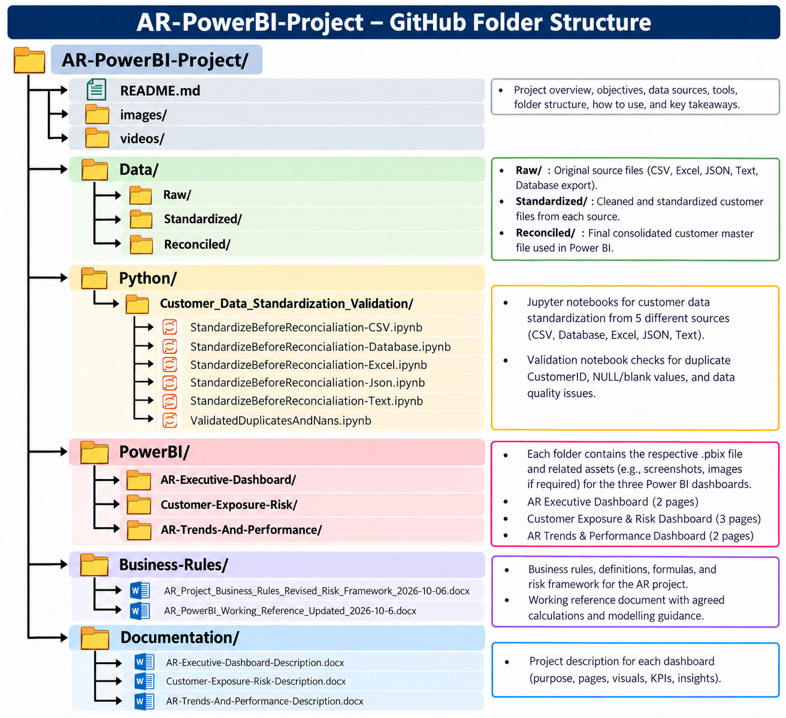

## 1.  Six notebooks form a legitimate data-preparation/validation component

The six notebooks collectively show a sensible pipeline:
Five customer-data source variants → standardization → duplicate/conflict checking → NULL/blank validation → reconciled customer dataset
The five source variants represented are:
- CSV
- Database
- Excel
- JSON
- Text / pipe-delimited text
The standardization notebooks consistently bring the source fields toward:
- CustomerID
- CustomerName
- Region
- CustomerSegment
- CreditLimit
and standardize customer-segment variants into:
- LargeEnterprise
- MidMarket
- SME
while normalizing Region values. For example, the CSV notebook explicitly performs the column renaming and segment standardization. The same overall process is implemented for the Database, JSON and Text variants.
That is absolutely relevant to an AR Power BI portfolio project.

## 2. The validation notebook makes the story considerably stronger

There are separate validation notebook that checks the standardized outputs.
It checks duplicate CustomerIDs separately for each source.
The actual executed results show:
| Source | Duplicate situation found |
| Excel | No duplicate CustomerID |
| CSV | C085 duplicated |
| Database | C110 duplicated |
| Text | C054 and C104 duplicated |
| JSON | C128 duplicated |

And importantly, the duplicate records weren't simply assumed to be conflicting. The notebook exposes the records so that they can be investigated.
For example, C110 in the database source has the same customer information in both occurrences, while the Text source contains materially different records for some duplicate IDs.
That's exactly the kind of data-quality investigation that makes a portfolio project more credible.

## 3. It also demonstrates missing-data validation

The validation notebook checks both:
- NULL
- blank / whitespace values
across the five standardized datasets.
The executed results expose examples such as:
C014 — missing CreditLimit
C052 — missing CreditLimit
C129 — missing CreditLimit
Text source — additional missing CustomerName/Region/CustomerSegment cases
JSON source — missing CustomerSegment in one record

## 4. The six notebooks also demonstrate data rarely arrives in exactly the same structure

For example, the notebooks handle different source-column naming conventions:
- CSV
- Customer_ID → CustomerID
- Customer_Name → CustomerName
- Region_Name → Region
- Segment → CustomerSegment
- Approved_Credit_Limit → CreditLimit
JSON/Text
- Cust_ID → CustomerID
- Cust_Name → CustomerName
- Area → Region
- Customer_Type → CustomerSegment
- Credit_Limit → CreditLimit
- Database
Different database-style names are mapped to the common analytical schema.
That is a genuine data-engineering/data-analyst task.
5.
> "The customer master data was simulated across five source-system formats: CSV, Excel, database-exported data, JSON-derived data, and pipe-delimited text. Each source variant was standardized into a common customer schema before reconciliation and validation."
> "All customer data used in this portfolio project is synthetic and created for analytical practice; it does not represent real customers or confidential business data."

## 6. Proposed GitHub structure could be:

The proposed project structure eventually follows:
Python data preparation → data quality → reconciliation → Power BI data model → business rules → dashboards → management insights

## 7. One technical limitation  but not a blockage

The data preparation and validation notebooks used during development of the  project  contain local Windows paths such as:
D:/PowerBI/ABC-AR-AP-Dashboard/...
Therefore, if somebody downloads the notebooks from GitHub and presses Run All, they won't automatically reproduce any results unless they recreate the local folder structure or change the paths. They may have to analyze them and do the needful changes

## 8. Final Reconciliation of Customer File: The AR project data model would ultimately have 4 tables- a) d-customer b) f-invoice c) f-payment d) d-calendar

While reconciliating all the validated files stimulated from different sources like excel, json, text, database and csv, it was found, that all the final structure of all the customers were same, there by it was not necessary to merge or reconcile all the sources. The excel format was found to be most suitable and was chosen to be input of d-customer table in Power BI data model

## 9. Invoice And Payment Tables: The invoice and payment tables are actually spread across different dates starting from Jan-1-2023 to July-31-2026. All of the invoice and payment data sources are in csv formats. July-31 2026 has been treated as the cut-off date for analysing any data in this project

## 10. Overall Portfolio Structural Flow

The overall AR portfolio is like a coherent end-to-end project:
Synthetic multi-source customer data
↓
Python standardization
↓
Duplicate & missing-value validation
↓
Customer reconciliation
↓
AR invoice/payment data model
↓
Defined AR business rules
↓
Revised customer-risk framework
↓
3 Power BI dashboards
↓
Management analysis

## 11) Future Enhancements and Present Limitations:

Potential future enhancements include:
- Scheduled data refresh to keep published reports updated as new data becomes available.
- Incremental refresh to refresh selected periods of historical data were supported and justified by data volume.
- Query-folding evaluation and optimization to improve data-refresh performance when using compatible data sources, such as SQL databases.
- Automated data-quality validation to identify missing values, duplicate records, and data inconsistencies.
- Refresh-failure notifications to identify unsuccessful data refreshes.
- Automated AR risk alerts to highlight customers requiring collection or credit-risk review.
These enhancements are outside the scope of the current implementation and may be evaluated in a subsequent phase.

## 12) Power BI Service Deployment and Access:

The three AR dashboards were published to Microsoft Power BI Service under a personal Microsoft Fabric Free account and are maintained in the private My workspace.

## 13) Portfolio access and licensing:

This portfolio initiative focuses on developing and demonstrating end-to-end Accounts Receivable analytics, including executive reporting, customer credit-risk analysis, ageing analysis, and collection-performance trends.
Interactive sharing with external users is outside the scope of the current implementation. The current free-license setup does not provide the required sharing capabilities for this use case, and no additional paid Power BI or Fabric capacity has been purchased for this portfolio.
Screenshots of the published dashboards are provided for demonstration and review. The corresponding Power BI Desktop (.pbix) files and project documentation are maintained in this repository, subject to the repository's stated data and usage terms.

## 14) Data and refresh considerations:

The dashboards use project datasets with a reporting cutoff date of July 31, 2026. Data refresh in Power BI Service depends on the configured data source, connectivity, and refresh settings. The publication of a report does not, by itself, guarantee automatic or scheduled refresh.
